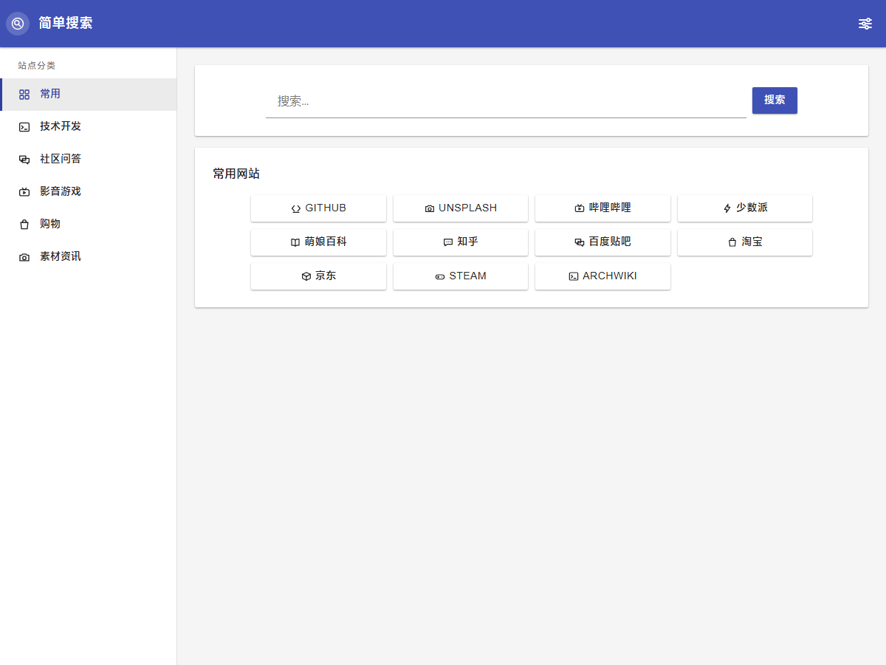

# SimpleSearch · 简单搜索

<strong>超简单的聚合搜索网站</strong> 
输入关键词点网站 = 在站内搜索 · 留空点网站 = 直接打开网站

纯静态 · 零依赖 · 双击即用 · 本地打开 3 毫秒

  
  
  
  
  

  <a href="https://github.com/breathiness/SimpleSearch/wiki">Wiki 文档</a> •
  <a href="#-核心功能">核心功能</a> •
  <a href="#-在线体验与下载">在线体验</a> •
  <a href="#-常用快捷键">快捷键</a> •
  <a href="#-常见问题">常见问题</a> •
  <a href="docs/CHANGELOG.md">更新日志</a>

---

## 📖 简介

**SimpleSearch（简单搜索）** 是一个纯静态的聚合搜索页：输入关键词，点哪个站点就在哪个站点里搜；不输入关键词直接点，就打开那个网站。

页面没有框架、没有运行时构建、没有第三方资源，核心功能全部在本地完成——唯一的例外是**默认开启、可一键关闭**的联网联想。可以部署到 GitHub Pages，也可以下载单文件版双击直接用。

## ✨ 核心功能

- **两种用法合一**：输入框负责「用当前搜索引擎搜」，站点按钮负责「去那个网站 / 在那个网站里搜」。
- **33 个内置站点、5 个分类**：技术开发 7、社区问答 6、影音游戏 8、购物 6、素材资讯 6；默认「常用」视图只显示最常用的 11 个，点分类展开全部。
- **`!bang` 快捷搜索**：`!gh rust`、`!b站 视频`，token 支持站点 id 与中文关键词。
- **自定义站点（v2.9）**：设置里可视化增删改自己的站点，存浏览器本地，不改代码、不用重新构建，自动进分类与 `!bang`；还能排序常用站点、导出 / 导入配置。
- **四个搜索引擎**：Bing / Google / DuckDuckGo / 百度，随时切换并记住；表单参数自动适配（百度用 `wd`）。
- **主题**：跟随系统 / 浅色 / 深色三态 + **19 组 MDUI 主色**，切换零请求、不闪屏。
- **PWA 离线**：装到桌面后断网刷新仍可用，设置里会出现「安装到桌面」引导，新版本就绪时底部提示刷新；另有**单文件便携版**（CSS/JS/图标全内联，零外部请求，双击即用）。
- **深链**：`?cat=` / `?q=` / `?site=` 只预填、预选，不自动跳转；配一个书签小工具把选中文字带进搜索框。
- **隐私**：无统计、无追踪、无广告、无网络字体；关掉联网联想后零第三方请求。

## 🚀 在线体验与下载

| 方式 | 说明 |
| :--- | :--- |
| **在线使用** | <https://breathiness.github.io/SimpleSearch/>（自动跟随系统深浅色） |
| **单文件便携版** | 下载 [`SimpleSearch.html`](raw/main/SimpleSearch.html)（约 207 KB，双击即用、零外部请求） |
| **装到桌面（PWA）** | Chrome / Edge 打开在线版 → 地址栏右侧「安装」，装完是独立窗口、可离线；设置里也会出现「安装到桌面」入口 |
| **本地运行** | `git clone` 后直接双击 `index.html`，不需要服务器、不需要 `npm install` |

> 想在本地改代码 / 跑测试？见 **[本地开发与测试](https://github.com/breathiness/SimpleSearch/wiki/本地开发与测试)**。

## 📚 使用指南与文档

详细说明放在 **[Wiki](https://github.com/breathiness/SimpleSearch/wiki)**：

| 文档 | 内容 |
| :--- | :--- |
| [功能详解](https://github.com/breathiness/SimpleSearch/wiki/功能详解) | 基本操作、`!bang`、分类导航、33 个内置站点、深链、设置面板、书签小工具、键盘操作 |
| [自定义站点](https://github.com/breathiness/SimpleSearch/wiki/自定义站点) | 在界面里添加自己的站点；或把站点写进仓库当内置 |
| [技术实现](https://github.com/breathiness/SimpleSearch/wiki/技术实现) | 纯静态架构、构建产物、PWA、单文件版、主题三态、内联 SVG sprite、体积与性能 |
| [本地开发与测试](https://github.com/breathiness/SimpleSearch/wiki/本地开发与测试) | 命令、测试基线、目录结构、视觉回归、体积门禁、每周站点巡检 |
| [常见问题](https://github.com/breathiness/SimpleSearch/wiki/常见问题) | 默认搜索引擎、数据存储、断网可用、清理数据等 |
| [更新日志](docs/CHANGELOG.md) | 各版本变化 |

## ⌨️ 常用快捷键

| 按键 | 作用 |
| :--- | :--- |
| `/` | 聚焦搜索框 |
| `↑` / `↓` | 在联想列表里上下移动 |
| `Enter` | 采用高亮联想项；无高亮时普通提交 |
| `Esc` | 关闭联想列表、分类抽屉、设置面板或对话框 |
| `Delete` | 删除高亮的历史联想项 |
| `Tab` | 移出搜索框并收起联想 |
| `?` | 打开快捷键说明（焦点不在输入框时） |
| `Ctrl` / `⌘` / `Alt` + 点站点按钮 | 新标签页打开 |

## ❓ 常见问题

<b>为什么不把简单搜索设为浏览器默认搜索引擎？</b>

这是有意不做的：搜索始终由你按回车或点按钮触发，`?q=` 只预填、不自动提交。想要「一键搜选中文字」可以用 Wiki 里的书签小工具。

<b>我的主题、历史、自定义站点会上传吗？</b>

不会。全部只存在浏览器本地 `localStorage`（7 个键），不含账号或身份信息；清理站点数据即可删除，也可以用「配置导出 / 导入」备份迁移。

<b>断网还能用吗？</b>

本地双击版本来就不需要网络；在线版装过 PWA 后断网刷新也能打开。联网联想断网时自动退回本地联想，设置里关掉后完全离线。

<b>怎么添加自己的网站？</b>

设置 →「我的站点」→ 管理 → 新增站点，填名称 / 首页 / 搜索模板（含 `{q}`）/ 分类即可，存本地、刷新还在、不用重新构建。详见 [自定义站点](https://github.com/breathiness/SimpleSearch/wiki/自定义站点)。

更多问题见 **[Wiki · 常见问题](https://github.com/breathiness/SimpleSearch/wiki/常见问题)**。

## 🔒 隐私

- 不接入任何统计、追踪、广告或指纹脚本；字体用系统字体栈，没有 CDN、网络字体。
- **联网联想默认开启**（关键词发给百度 `suggestion.baidu.com`，JSONP）；设置里关掉后**零第三方请求**，完全离线可用。
- 浏览器本地只存 7 个 `localStorage` 键（主题 / 主题色 / 引擎 / 历史 / 联想开关 / 自定义站点 / 常用顺序），不会上传。

## 📜 致谢与许可

灵感来自 AnywhereAnything 与 via 作者的 viayoo：输入关键词点网站即站内搜索，不输入直接点就打开网站。v2 起把站点收拢到一处、补齐了分类 / 主题 / PWA / `!bang` / 单文件版 / 自定义站点等能力，初衷没变。

界面风格参考 [MDUI](https://www.mdui.org/) / Material Design 1 —— 仅视觉规范，未引入其库或任何第三方资源。

[MIT](LICENSE) © 2023 breathiness

 

